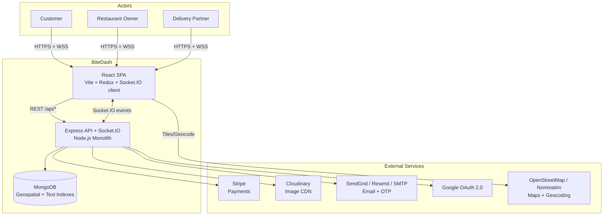
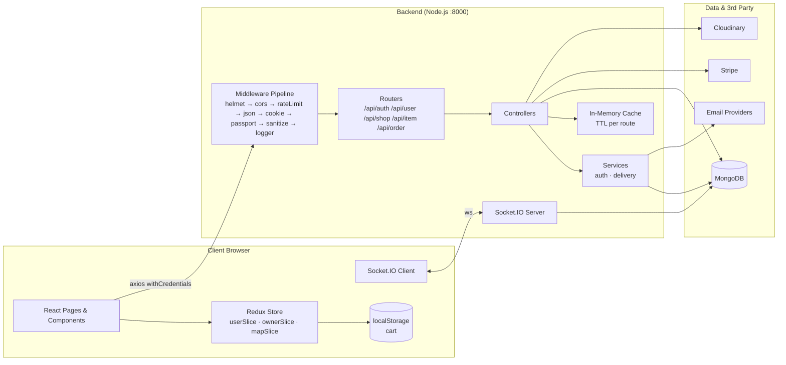
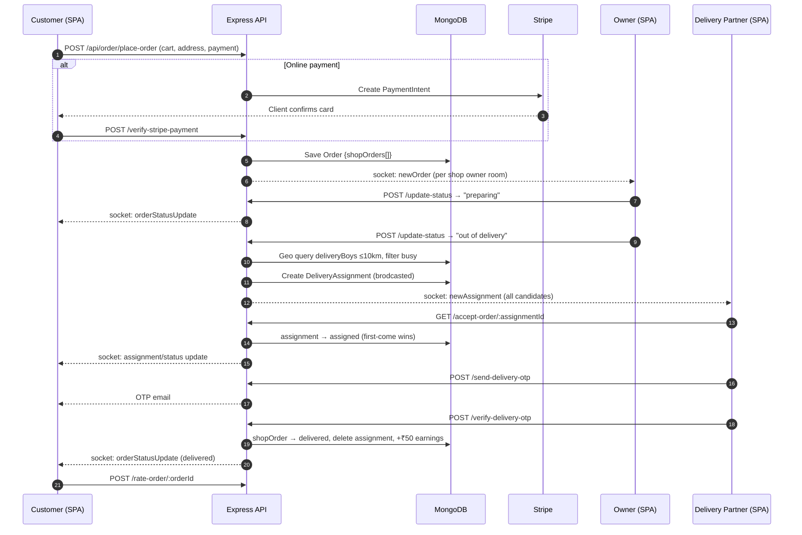
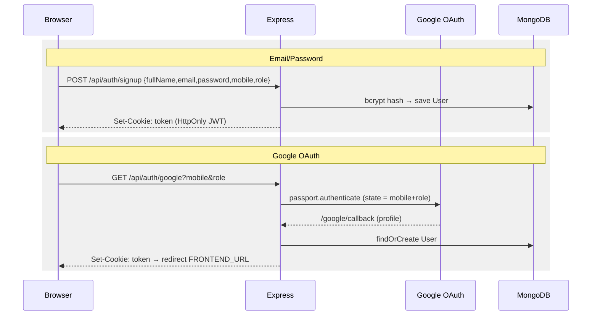
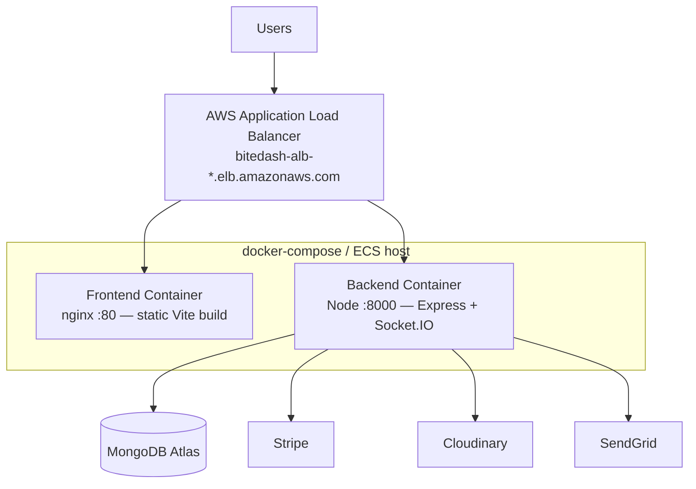

# BiteDash — High-Level Design (HLD)

> **Version:** 1.0 &nbsp;|&nbsp; **Author:** Adarsh Priyadarshi &nbsp;|&nbsp; **Status:** Living Document
>
> Premium Food Delivery Platform — Multi-role marketplace connecting Customers, Restaurant Owners, and Delivery Partners.

---

## Table of Contents

1. [Overview](#1-overview)
2. [Goals & Non-Goals](#2-goals--non-goals)
3. [Functional Requirements](#3-functional-requirements)
4. [Non-Functional Requirements](#4-non-functional-requirements)
5. [System Architecture](#5-system-architecture)
6. [Technology Stack](#6-technology-stack)
7. [Core Subsystems](#7-core-subsystems)
8. [Data Flow Diagrams](#8-data-flow-diagrams)
9. [Real-Time Communication Design](#9-real-time-communication-design)
10. [Security Architecture](#10-security-architecture)
11. [Scalability & Performance](#11-scalability--performance)
12. [Deployment Architecture](#12-deployment-architecture)
13. [Capacity Estimation](#13-capacity-estimation)
14. [Trade-offs & Design Decisions](#14-trade-offs--design-decisions)

---

## 1. Overview

BiteDash is a **full-stack food delivery marketplace** (like Zomato/Swiggy) with three actor roles:

| Actor | Description | Key Capabilities |
|---|---|---|
| **User (Customer)** | Orders food | Browse by city, cart, checkout (COD/Stripe), live order tracking, ratings |
| **Owner (Restaurant)** | Manages a shop | Create/edit shop, manage menu items, accept & progress orders, earnings dashboard |
| **Delivery Boy** | Delivers orders | Receive geo-broadcast assignments, accept orders, live GPS tracking, OTP-verified delivery |

The system is a classic **client–server monolith** with real-time capabilities:
- **Frontend:** React SPA (Vite), Redux Toolkit state, Socket.IO client
- **Backend:** Node.js/Express monolithic REST API + Socket.IO server
- **Database:** MongoDB (Mongoose ODM) with geospatial indexes
- **3rd-Party:** Stripe (payments), Cloudinary (images), SendGrid/Resend/Nodemailer (email), Google OAuth (auth), Leaflet/OSM (maps)

---

## 2. Goals & Non-Goals

### Goals
- ✅ Multi-role marketplace on a single codebase (user / owner / deliveryBoy)
- ✅ Multi-shop orders — one checkout can span several restaurants (order fan-out)
- ✅ Real-time order lifecycle updates and live delivery-partner GPS tracking
- ✅ Geospatial delivery assignment (nearest available partners within 10 km)
- ✅ Secure payments via Stripe + Cash-on-Delivery
- ✅ OTP-verified handover at delivery
- ✅ Horizontal scalability via Node cluster mode & stateless JWT auth

### Non-Goals (current scope)
- ❌ Microservices decomposition (deliberate monolith for team size/velocity)
- ❌ Multi-region active-active deployment
- ❌ Native mobile apps (responsive web only)
- ❌ Surge pricing / dynamic delivery fees

---

## 3. Functional Requirements

| # | Requirement | Module |
|---|---|---|
| FR-1 | Signup/Signin with email+password, Google OAuth, OTP-based password reset | Auth |
| FR-2 | Role-based dashboards (User / Owner / DeliveryBoy) rendered from one `Home` route | Frontend |
| FR-3 | City-scoped discovery of shops & items (geolocation → reverse geocode → city) | Catalog |
| FR-4 | Cart with localStorage hydration, multi-shop checkout | Ordering |
| FR-5 | Payment via COD or Stripe PaymentIntent, with server-side verification | Payments |
| FR-6 | Order fan-out: one Order → N ShopOrders (one per restaurant) | Ordering |
| FR-7 | Geo-broadcast of ready orders to available delivery partners (≤10 km) | Delivery |
| FR-8 | First-come-first-serve assignment acceptance | Delivery |
| FR-9 | Live GPS tracking of delivery partner on a map | Real-time |
| FR-10 | OTP verification at delivery handover | Delivery |
| FR-11 | Item ratings (5-star) and order ratings/reviews | Ratings |
| FR-12 | Owner earnings & delivery partner earnings (₹50/delivery) | Payouts |
| FR-13 | Image uploads for shops/items via Cloudinary | Media |

---

## 4. Non-Functional Requirements

| Category | Requirement | Implementation |
|---|---|---|
| **Performance** | p95 API latency < 300 ms for reads | In-memory response cache (30s–600s TTL), gzip compression, MongoDB indexes |
| **Scalability** | Scale with CPU cores | `cluster.js` (Node cluster), stateless JWT (no server session) |
| **Availability** | Health-checked containers, auto-restart | `/api/health` endpoint, Docker `restart: unless-stopped`, ALB health checks |
| **Security** | OWASP-aligned hardening | Helmet headers, CORS allowlist, rate limiting (global/auth/order/search), input sanitization, bcrypt, HttpOnly JWT cookies |
| **Reliability** | Graceful shutdown | SIGTERM/SIGINT drain with 10s force-kill timeout |
| **Observability** | Structured logging | Custom logger with request logging middleware |
| **UX** | Fast first paint | Route-level code splitting (React.lazy), lazy images, skeletons |

---

## 5. System Architecture

### 5.1 Context Diagram (C4 Level 1)

### 5.2 Container Diagram (C4 Level 2)

---

## 6. Technology Stack

| Layer | Technology | Rationale |
|---|---|---|
| Frontend framework | React 19 + Vite 7 | Fast HMR, code splitting, modern React features |
| State management | Redux Toolkit 2 | Predictable multi-role global state; socket instance & cart in store |
| Styling | Tailwind CSS 4 | Utility-first, consistent design system |
| Animations | Framer Motion | Polished micro-interactions |
| Maps | Leaflet + react-leaflet | Free OSM tiles; live tracking markers |
| Charts | Recharts | Owner dashboard analytics |
| Backend | Node.js 18+ / Express 5 | Mature ecosystem, single language across stack |
| Real-time | Socket.IO 4 | Rooms per userId, auto-reconnect, WS + polling fallback |
| Database | MongoDB + Mongoose 9 | Flexible document model, native `2dsphere` geo queries, text search |
| Auth | JWT (HttpOnly cookie) + Passport Google OAuth | Stateless horizontal scaling; social login |
| Payments | Stripe PaymentIntent | PCI-compliant card processing |
| Media | Cloudinary + Multer | Off-server image storage/CDN transforms |
| Email | SendGrid → Resend → Nodemailer (fallback chain) | Delivery reliability for OTP mails |
| Containerization | Docker + docker-compose | Reproducible deploys; ALB on AWS |
| Testing | Vitest + React Testing Library | Component & page tests |

---

## 7. Core Subsystems

### 7.1 Authentication & Authorization
- Email/password signup with **bcrypt** hashing; JWT issued in an **HttpOnly cookie**.
- Google OAuth 2.0 flow via Passport (`/api/auth/google` → callback → JWT cookie → redirect).
- Password reset: OTP mailed (SendGrid → Resend → SMTP fallback), verified, then reset.
- `isAuth` middleware validates JWT on every protected route; role checks in controllers.

### 7.2 Catalog & Discovery
- Browser geolocation → reverse geocoding → **city name** stored in Redux (`mapSlice`).
- Shops & items fetched **by city** (`/get-by-city/:city`) with 600 s server-side cache.
- Full-text item search (`searchItems`) with a dedicated search rate limiter.

### 7.3 Ordering & Payments
- Cart lives in Redux + localStorage (survives refresh).
- Checkout groups cart items **per shop** → single `Order` document containing `shopOrders[]`.
- **COD:** order placed immediately. **Online:** Stripe PaymentIntent created → client confirms → server verifies (`verify-stripe-payment`) → order activated.

### 7.4 Delivery Assignment (Geo-Broadcast)
1. Owner marks a shop-order **"out of delivery"**.
2. Backend runs a `$near` geo query — delivery partners with role `deliveryBoy` within **10 km** of the shop.
3. Busy partners (active assignment) filtered out.
4. `DeliveryAssignment` created with status `brodcasted`; candidates notified via Socket.IO `newAssignment`.
5. **First** partner to call `accept-order/:assignmentId` wins (status → `assigned`); others see it disappear.
6. On delivered (OTP verified), assignment is **deleted** and partner earnings incremented (₹50/delivery).

### 7.5 Real-Time Tracking
- Delivery partner's device emits `updateLocation` (lat/lng) → persisted to `User.location` → broadcast `updateDeliveryLocation` → customer's tracking map moves the marker live.

---

## 8. Data Flow Diagrams

### 8.1 End-to-End Order Lifecycle

### 8.2 Authentication Flow

---

## 9. Real-Time Communication Design

| Event | Direction | Purpose |
|---|---|---|
| `identity` | client → server | Bind `userId` → `socket.id`, join room `userId`, set `isOnline` |
| `updateLocation` | client → server | Delivery partner GPS ping → persist + rebroadcast |
| `updateDeliveryLocation` | server → all | Live marker movement on customer tracking map |
| `newOrder` | server → owner | New order notification for a restaurant |
| `orderStatusUpdate` | server → customer | Status transitions (pending → … → delivered) |
| `newAssignment` | server → delivery partners | Geo-broadcast of an available delivery job |

**Design choices:**
- **Room-per-user** (`socket.join(userId)`) enables targeted emits: `io.to(userId).emit(...)`.
- `socketId` persisted on the `User` document — allows emits from HTTP controllers (`app.set('io', io)` → `req.app.get('io')`).
- Reconnect strategy: 5 attempts, 1–5 s backoff, websocket with polling fallback.
- On `disconnect`, `socketId` cleared and `isOnline=false` (partner drops out of broadcast pools).

---

## 10. Security Architecture

| Threat | Mitigation |
|---|---|
| Credential theft | bcrypt (salted) password hashing; JWT in HttpOnly cookie (no JS access) |
| CSRF | SameSite cookie policy + CORS credential allowlist |
| Brute force | `authRateLimiter` on signin/signup/OTP endpoints |
| NoSQL injection / XSS | `sanitizeRequest` middleware scrubs request payloads |
| Payment tampering | Amount computed server-side; Stripe verification endpoint checks PaymentIntent status |
| Fake delivery confirmation | Time-boxed OTP emailed to customer, verified by partner at handover |
| API scraping / SEO leak | `X-Robots-Tag: noindex` on `/api/*`, rate limiting |
| DoS | 10 mb body limit, gzip, rate limiters, ALB in front |

---

## 11. Scalability & Performance

| Technique | Where | Effect |
|---|---|---|
| **Node cluster mode** | `cluster.js` — 1 worker/CPU core, auto-respawn on crash | Vertical multi-core utilization |
| **Stateless auth** | JWT cookie | Any worker/instance can serve any request |
| **Response caching** | `cacheMiddleware(ttl)` — items 60–600 s, search 30 s | Cuts read load on hot catalog endpoints |
| **DB indexes** | `createIndexes()` at boot — email unique, `location: 2dsphere`, item text index, shop.city | O(log n) lookups; efficient `$near` |
| **Gzip** | compression middleware | Smaller payloads |
| **Code splitting** | `React.lazy` per route | Smaller initial JS bundle |
| **Image CDN** | Cloudinary transforms | Offloads bandwidth from origin |

**Known scaling limits (future work):**
- In-memory cache & Socket.IO state are **per-process** → move to Redis (cache + Socket.IO adapter) for multi-instance fan-out.
- MongoDB single replica set → shard by city/region at high scale.

---

## 12. Deployment Architecture

- **docker-compose** orchestrates `frontend` (nginx, port 80) + `backend` (port 8000) on a shared bridge network.
- Health checks: `GET /api/health` (backend: DB state, uptime, memory) and `GET /health` (frontend) every 30 s.
- Config via environment variables: `MONGODB_URL`, `JWT_SECRET`, `STRIPE_SECRET_KEY`, `CLOUDINARY_*`, `SENDGRID_API_KEY`, `FRONTEND_URL`.
- Graceful shutdown drains HTTP connections on SIGTERM (10 s hard limit) — safe for rolling deploys.

---

## 13. Capacity Estimation

Assumptions for a mid-size city launch:

| Metric | Estimate | Notes |
|---|---|---|
| DAU | 50 000 | customers + owners + partners |
| Orders/day | 10 000 | ≈ 0.12 orders/s avg, ~1.2/s peak (10× peak factor) |
| Reads:Writes | ~ 20 : 1 | browsing dominates; caching absorbs most reads |
| Order doc size | ~ 3 KB | order + embedded shopOrders |
| Order storage/yr | ~ 11 GB | 10k × 3 KB × 365 |
| Concurrent sockets | ~ 5 000 peak | 1 socket per active session; Socket.IO handles ~10k/node comfortably |
| GPS pings | 1 ping / 5 s / active partner | 500 active partners ⇒ 100 writes/s peak → consider batching at scale |

**Conclusion:** a single 4-core node in cluster mode + MongoDB Atlas M20 handles this comfortably; Redis adapter needed beyond ~2 backend instances.

---

## 14. Trade-offs & Design Decisions

| Decision | Alternative | Why chosen |
|---|---|---|
| **Monolith** | Microservices | Small team, faster iteration, single deploy; clean internal layering (routes → controllers → services) keeps a future split cheap |
| **MongoDB** | PostgreSQL + PostGIS | Document model fits nested `shopOrders`; native 2dsphere geo queries; flexible schema evolution |
| **Embedded shopOrders** | Separate ShopOrder collection | Atomic order reads/writes, order always fetched whole; trade-off: cross-shop queries need aggregation |
| **JWT cookie** | Server sessions | Statelessness for horizontal scaling; HttpOnly mitigates XSS token theft |
| **Broadcast + FCFS assignment** | Dispatcher algorithm (Hungarian/greedy) | Simple, low-latency, self-load-balancing; partners self-select; trade-off: possible acceptance races (mitigated by status check on accept) |
| **In-memory cache** | Redis | Zero infra for v1; documented migration path when going multi-instance |
| **Socket.IO** | Raw WebSocket / SSE | Rooms, reconnection, fallbacks out-of-the-box |
| **DeliveryAssignment deleted on completion** | Soft-delete/archive | Keeps hot collection tiny; delivery history derived from Order.shopOrders |

---

*See [LLD.md](./LLD.md) for module-level design, schemas, API contracts, and class/sequence details.*
