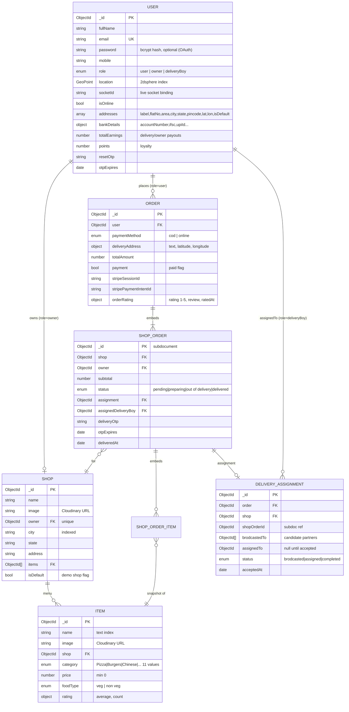
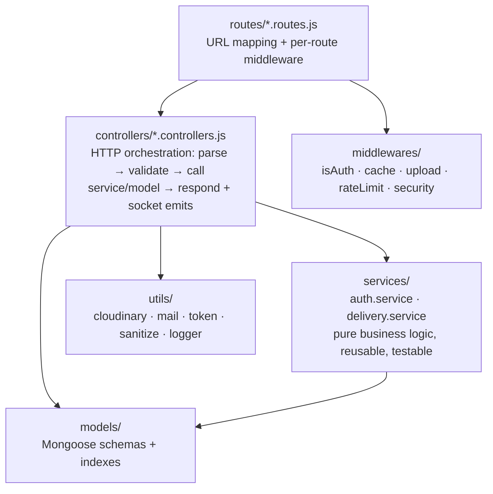
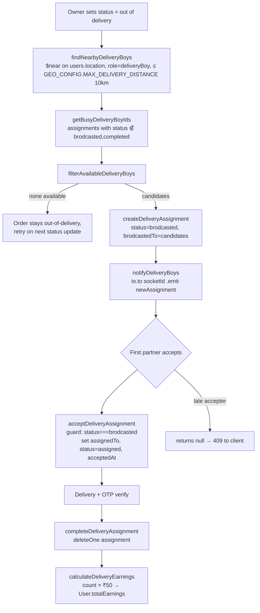
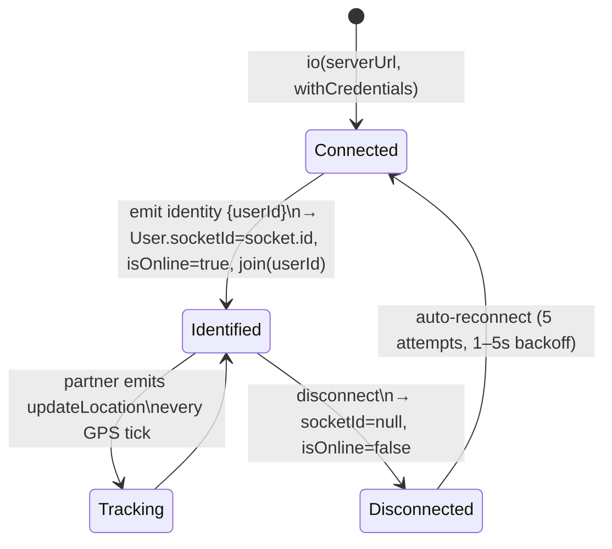
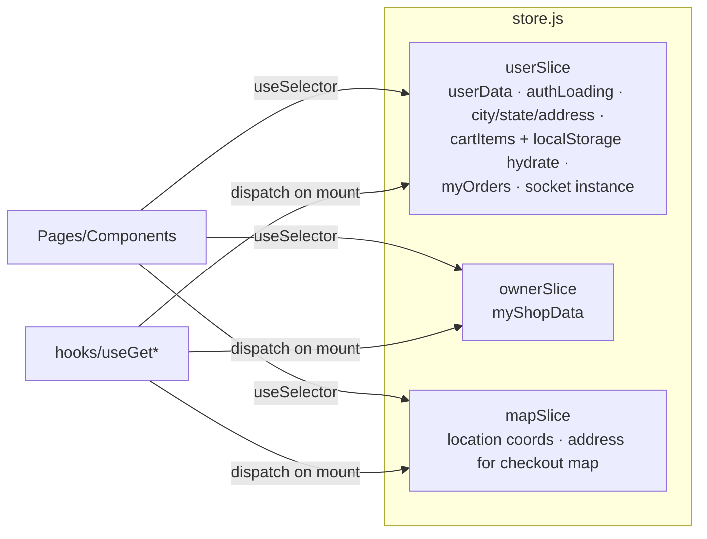
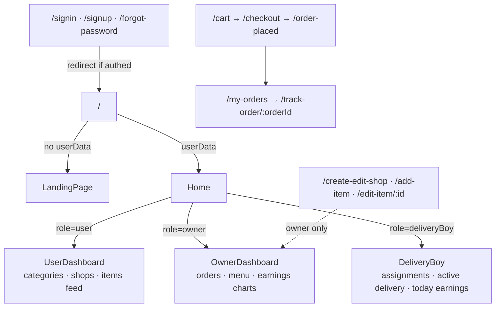
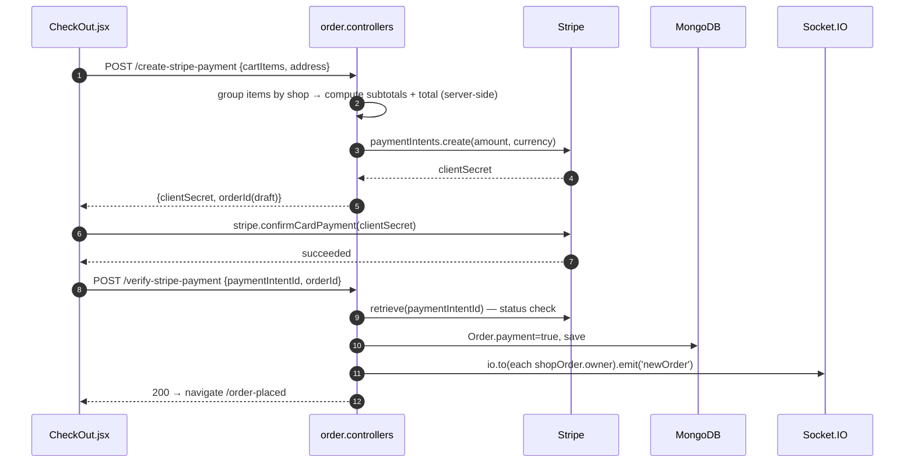
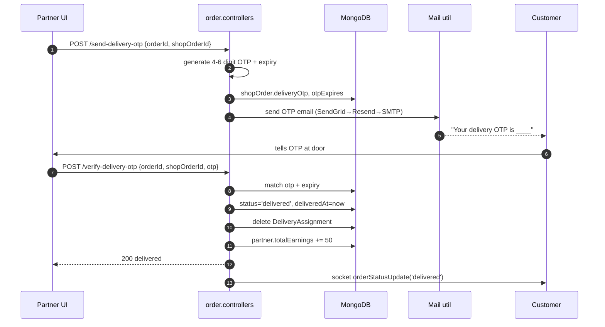
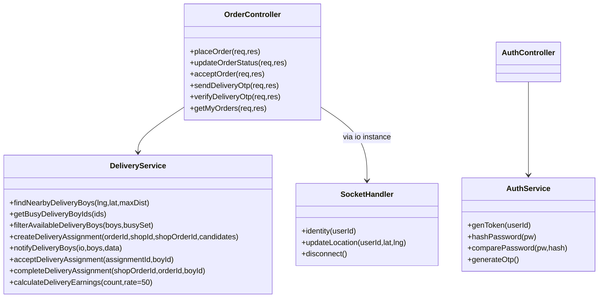

# BiteDash — Low-Level Design (LLD)

> **Version:** 1.0 &nbsp;|&nbsp; Companion to [HLD.md](./HLD.md)
>
> Module-level design: directory layout, database schemas, API contracts, middleware pipeline, state management, socket protocol, and detailed sequence flows.

---

## Table of Contents

1. [Codebase Layout](#1-codebase-layout)
2. [Database Design (ER + Schemas)](#2-database-design)
3. [API Specification](#3-api-specification)
4. [Backend Module Design](#4-backend-module-design)
5. [Middleware Pipeline](#5-middleware-pipeline)
6. [Services Layer](#6-services-layer)
7. [Socket.IO Protocol](#7-socketio-protocol)
8. [Frontend Design](#8-frontend-design)
9. [Detailed Sequence Designs](#9-detailed-sequence-designs)
10. [Error Handling & Logging](#10-error-handling--logging)
11. [Caching Design](#11-caching-design)
12. [Configuration & Environment](#12-configuration--environment)
13. [Testing Strategy](#13-testing-strategy)

---

## 1. Codebase Layout

```
BiteDash/
├── docker-compose.yml            # 2 services: backend :8000, frontend :80
├── backend/                      # Express 5 monolith (ESM)
│   ├── index.js                  # App entry: middleware → routers → socket → listen
│   ├── cluster.js                # Node cluster: 1 worker per CPU, respawn on exit
│   ├── socket.js                 # Socket.IO event handlers
│   ├── config/
│   │   ├── db.js                 # Mongoose connection
│   │   ├── indexes.js            # createIndexes() at boot
│   │   ├── passport.js           # Google OAuth strategy
│   │   ├── stripe.js             # Stripe SDK init
│   │   └── cache.js              # In-memory TTL cache store
│   ├── constants/index.js        # GEO_CONFIG, ASSIGNMENT_STATUS, ORDER_STATUS...
│   ├── models/                   # Mongoose schemas (5)
│   ├── routes/                   # Express routers (5)
│   ├── controllers/              # Request handlers (5)
│   ├── services/                 # Business logic (auth, delivery)
│   ├── middlewares/              # auth, cache, compression, rateLimit, security, upload
│   ├── validators/               # Request payload validation
│   └── utils/                    # cloudinary, mail (3 providers), token, logger, sanitize, errorHandler
└── frontend/                     # React 19 + Vite SPA
    └── src/
        ├── main.jsx              # Root render + Provider + Router
        ├── App.jsx               # Routes, socket bootstrap, auth gating
        ├── redux/                # store + userSlice + ownerSlice + mapSlice
        ├── hooks/                # Data-fetching hooks (useGetCurrentUser, ...)
        ├── pages/                # 20 route-level pages (lazy-loaded)
        ├── components/           # Reusable UI + 3 role dashboards
        ├── constants/            # categories, config
        └── utils/                # helpers
```

---

## 2. Database Design

### 2.1 Entity–Relationship Diagram



### 2.2 Indexes

| Collection | Index | Type | Purpose |
|---|---|---|---|
| users | `email` | unique | login lookup, dedupe |
| users | `location` | 2dsphere | `$near` delivery-partner search |
| shops | `owner` | unique | one shop per owner |
| shops | `city` | single | city discovery |
| items | `shop`, `category` | single | menu & category filters |
| items | `name` | text | `search-items` |
| orders | `user`, `shopOrders.owner`, `shopOrders.assignedDeliveryBoy` | single | my-orders per role |
| deliveryassignments | `order`, `assignedTo`, `status` | single | busy-check, accept |

### 2.3 Key Modeling Decisions

- **`shopOrders` embedded in `Order`** — one checkout spanning N shops is written atomically; each subdoc has its own `status`, delivery partner, and OTP. Owners query orders via `shopOrders.owner`.
- **`shopOrderItems` are snapshots** (`name`, `price`, `quantity` copied) — price changes never mutate historical orders.
- **`User.socketId`** — bridges HTTP controllers and Socket.IO (targeted emit without a shared broker).
- **`DeliveryAssignment` is ephemeral** — deleted on completion; keeps broadcast/busy queries on a small hot collection.

---

## 3. API Specification

Base URL: `/api` · Auth: JWT in HttpOnly cookie (`isAuth`) · Content: JSON unless noted.

### 3.1 Auth — `/api/auth`

| Method | Endpoint | Auth | Rate limit | Description |
|---|---|---|---|---|
| POST | `/signup` | — | auth | Create user `{fullName,email,password,mobile,role}` → sets JWT cookie |
| POST | `/signin` | — | auth | Email+password login → JWT cookie |
| GET | `/signout` | — | — | Clears cookie |
| POST | `/send-otp` | — | auth | Emails reset OTP (SendGrid→Resend→SMTP fallback) |
| POST | `/verify-otp` | — | auth | Validates OTP + expiry |
| POST | `/reset-password` | — | auth | Sets new password (post OTP verify) |
| POST | `/google-auth` | — | auth | Token-based Google sign-in |
| GET | `/google` | — | — | OAuth redirect (state carries `mobile`,`role`); 503 if not configured |
| GET | `/google/callback` | — | — | Issues JWT cookie, redirects to `FRONTEND_URL` |

### 3.2 User — `/api/user`

| Method | Endpoint | Description |
|---|---|---|
| GET | `/current` | Current user from JWT |
| POST | `/update-location` | Persist GeoJSON Point `[lng,lat]` |
| POST | `/update-bank-details` · GET `/get-bank-details` | Payout details (owner/partner) |
| POST | `/add-address` · PUT `/update-address` · DELETE `/remove-address/:addressId` | Address book CRUD |
| PUT | `/update-profile` | Name/mobile updates |
| GET | `/profile-stats` | Aggregated per-role stats |

### 3.3 Shop — `/api/shop`

| Method | Endpoint | Cache | Description |
|---|---|---|---|
| POST | `/create-edit` | — | Upsert shop; multipart `image` → Cloudinary |
| GET | `/get-my` | — | Owner's shop with populated items |
| GET | `/get-by-city/:city` | 600 s | City shop listing (public) |

### 3.4 Item — `/api/item`

| Method | Endpoint | Cache / Limit | Description |
|---|---|---|---|
| GET | `/all-items` | 60 s | Full catalog |
| POST | `/add-item` · POST `/edit-item/:itemId` | — | Owner CRUD, multipart image |
| GET | `/delete/:itemId` | — | Delete item (owner) |
| POST | `/rating` | — | Rate item 1–5 → recompute average |
| GET | `/get-by-id/:itemId` | 120 s | Item detail |
| GET | `/get-by-city/:city` | 600 s | City item feed (public) |
| GET | `/get-by-shop/:shopId` | 600 s | Shop menu |
| GET | `/search-items` | 30 s + search limiter | Text search `?query=&city=` |

### 3.5 Order — `/api/order`

| Method | Endpoint | Limit | Description |
|---|---|---|---|
| POST | `/place-order` | order | Create Order with per-shop fan-out; emits `newOrder` |
| POST | `/create-stripe-payment` | order | Stripe PaymentIntent, amount computed server-side |
| POST | `/verify-stripe-payment` | — | Confirms intent status, activates order |
| GET | `/my-orders` | — | Role-aware: customer orders / owner shopOrders / partner deliveries |
| POST | `/update-status/:orderId/:shopId` | — | Owner transitions status; triggers geo-broadcast on "out of delivery" |
| GET | `/get-assignments` | — | Partner: pending broadcasts addressed to them |
| GET | `/accept-order/:assignmentId` | — | FCFS accept (guard: status must still be `brodcasted`) |
| GET | `/get-current-order` | — | Partner's active delivery with customer/shop coords |
| POST | `/send-delivery-otp` · `/verify-delivery-otp` | — | OTP handover → `delivered`, +₹50 earnings, assignment deleted |
| GET | `/get-order-by-id/:orderId` | — | Tracking page payload |
| GET | `/get-today-deliveries` | — | Partner daily earnings histogram |
| POST | `/cancel-order` · DELETE `/delete-order/:orderId` | — | Cancellation (guarded by status) |
| POST | `/rate-order/:orderId` | — | 1–5 rating + review |

**Standard error envelope:** `{ "error": string }` with 400/401/403/404/429/500. Production hides internals (`Internal server error`).

---

## 4. Backend Module Design

### 4.1 Layered Architecture



**Conventions**
- Controllers never talk to sockets directly by socket internals — they resolve `io` via `req.app.get('io')` and emit to room `userId` or stored `socketId`.
- Services are framework-free (no `req`/`res`) — e.g. `delivery.service.js` exports 9 pure functions.
- Validators (`validators/*.validator.js`) run before controller logic for auth/order/shop payloads.

### 4.2 Controller Responsibilities

| Controller | Key functions |
|---|---|
| `auth.controllers` | signUp, signIn, signOut, sendOtp, verifyOtp, resetPassword, googleAuth |
| `user.controllers` | getCurrentUser, updateUserLocation, bank details, address CRUD, updateProfile, getProfileStats |
| `shop.controllers` | createEditShop (Cloudinary upload), getMyShop, getShopByCity |
| `item.controllers` | addItem, editItem, deleteItem, getItemByCity/Shop/Id, searchItems, rating |
| `order.controllers` | placeOrder (fan-out), Stripe create/verify, updateOrderStatus (+broadcast), acceptOrder, OTP send/verify, getMyOrders (role-aware), tracking getters, rateOrder |

---

## 5. Middleware Pipeline

Ordered exactly as registered in `index.js`:

| # | Middleware | Config | Notes |
|---|---|---|---|
| 1 | `securityHeaders` (helmet) | CSP, HSTS, nosniff... | first — applies to everything |
| 2 | `cors(corsOptions)` | allowlist: localhost:5173/5174, ALB URL, `FRONTEND_URL`; `credentials:true` | dynamic origin callback |
| 3 | `trust proxy = 1` | — | correct client IP behind ALB for rate limiting |
| 4 | `rateLimiter` (global) | per-IP window | + scoped: `authRateLimiter`, `orderRateLimiter`, `searchRateLimiter` |
| 5 | `express.json / urlencoded` | limit `10mb` | image-less JSON bodies |
| 6 | `cookieParser` | — | JWT cookie extraction |
| 7 | `passport.initialize` | — | Google OAuth only (no sessions) |
| 8 | `sanitizeRequest` | — | strips NoSQL operators / script tags |
| 9 | `logger.requestLogger()` | — | structured req logs |
| 10 | static + `X-Robots-Tag` on `/api` | — | `noindex,nofollow` |
| 11 | Routers → error handler → 404 | — | error handler logs & masks in prod |

**Per-route middleware:** `isAuth` (JWT verify → `req.userId`), `upload.single('image')` (Multer memory → Cloudinary), `cacheMiddleware(ttlSeconds)`.

---

## 6. Services Layer

### 6.1 `delivery.service.js` — assignment engine



**Race-condition guard:** `acceptDeliveryAssignment` re-reads the assignment and only proceeds when `status === 'brodcasted'` — the first write wins; later accepts get `null`.

### 6.2 `auth.service.js`
Token generation (`genToken` — JWT signed with `JWT_SECRET`), password hash/compare, OTP generate + expiry management, user lookup helpers used by both password and OAuth paths.

---

## 7. Socket.IO Protocol

### 7.1 Connection Lifecycle



### 7.2 Event Contracts

| Event | Payload | Emitter → Receiver |
|---|---|---|
| `identity` | `{ userId }` | client → server |
| `updateLocation` | `{ userId, latitude, longitude }` | partner client → server |
| `updateDeliveryLocation` | `{ deliveryBoyId, latitude, longitude }` | server → all clients (tracking pages filter by id) |
| `newOrder` | order summary | server → owner room/socketId |
| `orderStatusUpdate` | `{ orderId, shopId, status }` | server → customer room |
| `newAssignment` | `{ sentTo, assignmentId, orderId, shopName, deliveryAddress, items, subtotal }` | server → each candidate's socketId |

**Server config:** `pingTimeout 60s`, `pingInterval 25s`, transports `[websocket, polling]`.
**Client bootstrap (App.jsx):** socket created only when `userData` exists; instance stored in Redux (`setSocket`); disconnected on unmount/logout.

---

## 8. Frontend Design

### 8.1 Redux Store



**Cart design:** reducers `addToCart / removeCartItem / updateQuantity / clearCart` mirror to `localStorage`; `hydrateCart()` dispatched once at App mount — cart survives refresh without a backend call.

### 8.2 Data-Fetching Hooks (axios + Redux, no useEffect-fetch in components)

| Hook | Endpoint | Populates |
|---|---|---|
| `useGetCurrentUser` | `GET /user/current` | `userData`, ends `authLoading` |
| `useGetCity` | browser geolocation + reverse geocode | `city/state/address` |
| `useGetShopByCity` | `GET /shop/get-by-city/:city` | shop list |
| `useGetItemsByCity` | `GET /item/get-by-city/:city` | item feed |
| `useGetMyShop` | `GET /shop/get-my` | `ownerSlice.myShopData` |
| `useGetMyOrders` | `GET /order/my-orders` | role-aware orders |
| `useUpdateLocation` | `POST /user/update-location` | keeps server location fresh |

### 8.3 Routing & Role Gating



- All private routes: `element={userData ? <Page/> : <Navigate to="/signin"/>}`.
- Every page is `React.lazy` behind a shared `<Suspense>` fallback; `ErrorBoundary` wraps the tree.

### 8.4 Notable Components

| Component | Responsibility |
|---|---|
| `Nav` | search, cart badge, location display, role-aware actions |
| `FoodCard` / `RestaurantCard` / `CategoryCard` | catalog cards, add-to-cart |
| `OwnerOrderCard` | status dropdown → `update-status` API |
| `DeliveryBoyTracking` | Leaflet map, partner marker driven by `updateDeliveryLocation` |
| `UserOrderCard` | status timeline, rate/track actions |
| `AddressAutocomplete` / `AddressModal` | Nominatim search, saved address book |
| `LazyImage` | IntersectionObserver lazy loading |
| `ErrorBoundary` | crash containment + retry UI |

---

## 9. Detailed Sequence Designs

### 9.1 Place Order (multi-shop fan-out, online payment)



### 9.2 OTP-Verified Delivery Handover



### 9.3 Class-Level View (backend core)



---

## 10. Error Handling & Logging

| Layer | Mechanism |
|---|---|
| Controllers | try/catch → `res.status(4xx/5xx).json({error})`; `utils/errorHandler.js` helpers |
| Global | Express error middleware: logs `{method,url,ip}` via `logger.error`; masks message in production |
| 404 | Terminal catch-all `{error:'Not found'}` |
| Frontend | axios interceptors + `react-hot-toast` for user feedback; `ErrorBoundary` for render crashes |
| Logger | `utils/logger.js` — leveled (`info/warn/error`), structured metadata, `requestLogger()` middleware |
| Sockets | every handler try/caught; malformed payloads logged and dropped (never crash the connection) |

---

## 11. Caching Design

| Route | TTL | Invalidation approach |
|---|---|---|
| `GET /item/get-by-city/:city`, `/get-by-shop/:shopId`, `GET /shop/get-by-city/:city` | 600 s | TTL expiry (catalog changes tolerate 10-min staleness) |
| `GET /item/get-by-id/:itemId` | 120 s | TTL |
| `GET /item/all-items` | 60 s | TTL |
| `GET /item/search-items` | 30 s | TTL (search freshness) |

- Store: in-process Map keyed by URL (`config/cache.js`), value + expiry timestamp.
- **Never cached:** anything auth-personalized (orders, current user, assignments).
- **Multi-instance caveat:** cache is per-process; replace with Redis when running >1 backend replica (documented in HLD §11).

---

## 12. Configuration & Environment

| Variable | Used by | Purpose |
|---|---|---|
| `PORT` | index.js | default 8000 |
| `MONGODB_URL` | config/db.js | Atlas connection string |
| `JWT_SECRET` | token util / isAuth | JWT signing |
| `FRONTEND_URL` | CORS, OAuth redirects | deployed SPA origin |
| `STRIPE_SECRET_KEY` | config/stripe.js | payments |
| `CLOUDINARY_CLOUD_NAME/API_KEY/API_SECRET` | utils/cloudinary.js | image uploads |
| `SENDGRID_API_KEY` / `RESEND_API_KEY` / SMTP creds | mail utils | OTP emails (fallback chain) |
| `GOOGLE_CLIENT_ID/SECRET` | passport.js | OAuth (feature-flagged: 503 when absent) |
| `VITE_API_BASE` | frontend | API origin (falls back to ALB in prod, localhost:8000 in dev) |

Run modes: `npm run dev` (nodemon) · `npm start` · `npm run start:cluster` (multi-core) · seeds: `seed:default`, `seed:users`.

---

## 13. Testing Strategy

| Level | Tooling | Coverage |
|---|---|---|
| Component | Vitest + RTL + jsdom | `FoodCard`, `Nav`, `OwnerDashboard` |
| Page | Vitest + RTL | 11 page suites: Home, CartPage, CheckOut, CategoryPage, CreateEditShop, AddItem, EditItem, ForgotPassword, LandingPage, MyOrders, OrderPlaced |
| App | `App.test.jsx` | routing/auth-gating smoke |
| Recommended additions | supertest (API), mongodb-memory-server (models), socket.io-client (events) | backend currently untested — highest-value gap |

---

*End of LLD. For architecture rationale, capacity math, and deployment topology see [HLD.md](./HLD.md).*
